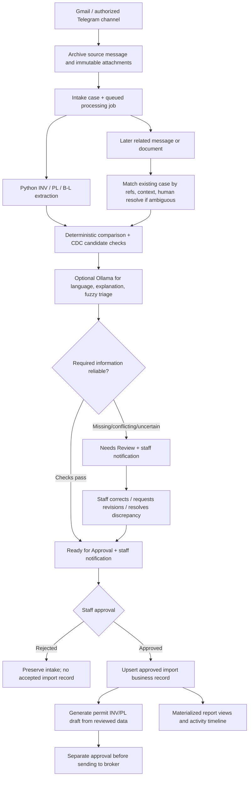

# Shipping Agency AI Automation System — Implementation Specification

**Version:** 1.0 | **Date:** 2026-11-13 | **Status:** Proposed engineering baseline

## 1. Product scope and objective

Transform the existing Python/Streamlit CDC Excel Matcher into an internal AI-assisted import-document and operations platform for **local shipping agency staff** in Cambodia. Overseas/HQ colleagues are people communicating via existing channels; they are **not** additional users of the application in MVP.

Primary value:
- Eliminate repetitive manual download, classification, extraction, comparison, filing and Excel entry.
- Preserve original evidence, user corrections, approvals and outgoing communication.
- Turn new documents and later replies into a single continuous import-case workflow.
- Generate permit INV/PL drafts and structured reports from reviewed data.
- Keep humans responsible for critical decisions, official documentation, external sending, and CDC eligibility/balance actions.

Not in MVP: public partner portals, autonomous customs filing, integration with government systems, freight pricing/booking marketplaces, automatic final CDC stock deduction, training a custom LLM, or multi-agent autonomy.

## 2. Existing repository: preserve and reuse

Source: `https://github.com/dev-vichea/cdc_excel_matcher_v1`.

Observed existing project:
- `app.py`, `shipping_ui.py`, `app_pages/`: Streamlit prototype.
- `services/extraction.py`: supplier Excel extraction.
- `services/packing.py`: packing list parsing/comparison.
- `services/bill_extractor.py`: B/L PDF extraction with OCR fallback for some scans.
- `services/matching.py`: conservative CDC candidate ranking and translation logic.
- `services/translation_memory.py`: persisted verified terminology.
- `services/permit_exporter.py`: review-only permit INV/PL generation.
- `services/cutstock_updater.py`: preparation of monthly Excel cut-stock updates.
- `services/shipping_store.py`: SQLite shipment/document/event prototype.
- `ui_demo/`: browser-only UI exploration; not persistent.
- `tests/`: pre-existing unittest regression tests.
- Existing Dockerfile and `docker-compose.yml` run Streamlit on port `8501`.

**Migration strategy:** Keep all original services and their contracts working until tested adapters exist. Do not delete Streamlit, destroy SQLite data, or replace original workbooks. Add a new application layer in parallel, then migrate incrementally through explicitly tested import scripts. Avoid a speculative wholesale rewrite.

## 3. Core business language

- **Intake case:** A captured message plus attachments and proposed extracted data, before acceptance by staff. Persists even if extraction fails.
- **Import record:** Approved business record with a generated immutable DB ID; invoice number is its prominent user-facing reference.
- **Document:** Immutable stored file with type, content hash, source message, version/parent link, received time and provenance.
- **Shipment/transport movement:** May link to one or more invoice records and B/L/container references; relationship is not assumed 1:1.
- **CDC Master List version:** Company- and approval-reference-specific imported list with item definitions and optional quantity/value balance fields.
- **AI proposal:** Typed, untrusted interpretation that never itself commits a business approval.
- **Approval:** Identifies actor, exact action scope, review snapshot, timestamp and result.
- **Permit INV/PL:** Generated **draft document** until separately verified/authorized; not an approved customs permit.

### Distinguish every state

Store states independently. `permit_draft_generated` is not equal to `permit_sent`, `customs_clearance_in_progress` is not equal to `customs_released`, and `documents_received` is not equal to `record_approved`.

## 4. End-to-end business workflow (canonical)



### Detailed processing behavior

**Step 1 — Intake**
- Ingest **only authorized** channel events. Archive original message headers/metadata, source IDs, attachments, checksum and receive timestamp.
- Do not require the invoice number to save the intake; a case without a reference must still exist.
- Use channel-provider message IDs and attachment hashes to deduplicate repeated deliveries.
- Uploaded/manual or simulated events must pass through the same pipeline used by future connectors.

**Step 2 — Extract**
- Identify file type and logical document type (`invoice`, `packing_list`, `draft_bl`, `other`).
- Reuse Python Excel parsers for `.xls`/`.xlsx`, PyMuPDF/PDF text + controlled OCR fallback, and document-specific adapters.
- Capture field source attribution: document id, sheet/page, cell/line or available evidence snippet, extraction method, revision and original text.
- Represent missing values as null/pending, never guesses. Store unit and currency, not numbers without dimensions.

**Step 3 — Cross-document and CDC checks**
- INV vs PL: company/parties where present, item descriptions, quantities, units, package count, net/gross weights and totals; use normalization and documented conversion rules.
- INV/PL vs Draft B/L: shipper, consignee, notify party, loading/discharge locations, B/L/booking/container/seal references, cargo **summary**, packages and weights where present. Do not assume detailed B/L item/price lines exist.
- CDC: select verified master list for correct company, year and approval/QIP/CIB reference. Suggest candidate descriptions using the existing fuzzy matcher and verified translations; compare units, unit price if master template provides it, quantities, approved values and remaining balances **where actually available**.
- A good textual similarity score does not prove approved CDC eligibility; type/spec/HS and units may require staff judgment.
- If formula-driven CDC balances are missing or stale, set `balance_unknown` and prevent auto-approval of balance-dependent checks.
- Use `Decimal` for money, quantized units where appropriate, explicit tolerances and conversion rules; never calculate financial values with binary floats.
- Preserve original supplier fields separately from staff-reviewed normalized fields.

**Step 4 — AI interpretation**
- Optional model: local Ollama `qwen3.5:4b-q4_K_M` on Apple Silicon Mac 16 GB, 4K context initially, at most one concurrent generation.
- Primary AI tasks: understand English/Chinese/Khmer shipping messages; map alternate terminology; explain discrepancies; propose follow-up requests; suggest linkage to an existing intake; draft natural responses.
- AI receives **minimal, redacted or approved-for-processing contextual data**, ideally extracted text only, not raw files unless needed.
- Require a versioned prompt, structured Pydantic/JSON output and a server-side validation pass. Store model name, prompt version and trace ID.
- Never let the model call direct write/sending/CDC stock tools. It returns proposals; backend validates and human approval determines execution.
- On model outage, delay AI-only tasks while deterministic extraction continues; make a manual review task with no silent fallback to uncertain data.

**Step 5 — Human review and approval**
- `needs_review`: no business write; show per-field evidence, conflicts, source document viewer and editable reviewed values.
- `ready_for_approval`: all *configured required* checks pass; still requires a staff confirmation for MVP.
- Approval commits a precise reviewed snapshot: create/update import record, source-linked item lines, events and generated (unsubmitted) permit draft(s).
- Failed or rejected proposals remain in the intake/audit history.
- Approval of intake **does not mean** approval of B/L, CDC eligibility, document sending or customs release. Allow distinct approval scopes.

**Step 6 — Permit docs and report update**
- Use existing reviewed permit exporter; isolate Excel styling/template implementation.
- Permit draft may be generated when its actual required fields are verified, even when ETD/ETA or final B/L is still missing.
- Staff approval to send to a named customs broker is separate; preserve exact outbound message/document snapshot and delivery status.
- Monthly/yearly reports query approved structured records and tagged actual events; support a consistent Excel export. Never silently alter original report templates.

**Step 7 — Long-running case**
- New arrival/update messages: match to case by invoice reference, B/L, thread/conversation ID, source sender, document similarity, and human review when ambiguous.
- A revised document creates a **new version**, does not overwrite the source or previous decisions.
- Changes that affect already-approved fields create review tasks or require re-approval; update dependent documents and reports only after authorization.
- Unknown, expected and confirmed ETD/ETA are separate statuses. Timestamp sources and track changes.
- Future customs: broker sends permit/declaration/release docs; staff confirms actual customs release evidence. CDC cut-stock only after applicable clearance-based reconciliation and explicit approval.

## 5. Automation architecture

```text
INBOUND: Gmail Pub/Sub+history / Telegram bot webhook or polling / test-upload
       -> FastAPI authenticated ingress adapter
       -> normalized incoming_event + immutable attachment storage
       -> transactionally enqueue background job / outbox record
       -> Redis + Celery worker (one worker process initially)
           [extract -> compare -> CDC -> optional LLM -> triage]
       -> PostgreSQL intake_case + extracted_fields + review findings
       -> in-app notification (+ optional Telegram staff alert)
       -> staff reviews in Next.js, FastAPI validates approval scope
       -> approved import data + generated permit draft + report updates
       -> later related events resume case
```

**One worker process** to begin, containing **several typed tasks**; NOT an autonomous all-powerful LLM worker. Distinct logical queues are optional initially. Later scale CPU-heavy OCR and LLM work into separate worker processes if needed. Use database-backed state and explicit transitions; Celery tasks are transient execution units, not the source of truth.

**Reliability:** unique `(channel, provider_message_id)` / `(source_id, attachment_hash)` as appropriate, idempotent tasks, transaction/outbox or equivalent safe enqueue, retries with backoff, dead-letter/failed status, manual reprocess, trace IDs and status dashboard. Protect against inbound/outbound email loops.

## 6. Technology choices & local development

| Component | Choice | Reason |
| --- | --- | --- |
| Web | Next.js + TypeScript + Tailwind + shadcn/ui | Internal professional UI and review forms |
| API | Python FastAPI, Pydantic | Reuse document engine, typed APIs |
| Data | PostgreSQL + SQLAlchemy 2 + Alembic | Durable workflow, audit data and migrations |
| Worker | Celery + Redis | Background extraction and follow-up tasks |
| AI | Ollama local model with provider abstraction | Free local inference; swappable later |
| Files | Private local storage MVP, object storage adapter later | Immutable originals and generated versions |
| Auth | Session/JWT as appropriate, hashed passwords, staff access | No public partner accounts |
| Testing | Existing unittest; pytest backend; Playwright frontend E2E | Legacy compatibility + acceptance |
| Development | Docker Compose for web/API/DB/Redis/worker; Ollama on macOS host | Avoid Docker GPU setup on 16 GB Mac |

**Connection detail:** Docker containers on macOS reach host Ollama via `http://host.docker.internal:11434`, subject to secure Ollama listener access; a Mac-hosted FastAPI process uses `http://127.0.0.1:11434`. Do not expose Ollama unauthenticated to the public internet. A localhost-only service may need a safe host-binding adjustment for containers to reach it; verify connectivity rather than assuming it works.

**Ports (proposed, detect collisions):** web `3000`, API `8000`, original Streamlit `8501` stays intact, PostgreSQL/Redis private inside Compose unless development access required. Keep existing Compose functionality—prefer a new `compose.dev.yml` or carefully merged services.

**Model caution:** A 4B model can misread or hallucinate values; never rely on it as source-of-truth for numeric comparisons. Mac 16 GB can handle one short inference at a time, but not a heavy multi-tenant production workload. Production requires an always-on worker and approved AI hosting arrangement.

## 7. Proposed domain/data model (initial)

| Entity | Critical fields / constraints |
| --- | --- |
| `users` | id, email, password hash or SSO id, active, created_at |
| `intake_cases` | id, state, detected_reference_nullable, channel, created_at, updated_at, review_reason |
| `incoming_messages` | id, channel, provider_message_id, thread/chat ID, sender, received_at, body, raw_metadata_ref; unique channel+provider ID |
| `documents` | id, intake_case_id, import_record_id nullable, classification, original_filename, mime, sha256, private_storage_key, received_at, source_message_id, parent_version_id nullable, is_generated |
| `document_extractions` | id, document_id, parser/model_version, raw_payload_ref, status, errors, extracted_at |
| `extracted_fields` | id, extraction_id, field_key, raw_value, normalized_value, unit, status, evidence locator, confidence_hint |
| `review_findings` | id, case_id, rule_id, severity, field refs, explanation, resolution, reviewer_id |
| `approvals` | id, case_id/import_id, action_scope, reviewed_snapshot_hash, decision, actor_id, approved_at, notes |
| `import_records` | id UUID, company_id, invoice_no, supplier, consignee, state, dates with statuses, created_at; uniqueness rules scoped and validated |
| `import_items` | id, import_id, source document rows, raw/normalized desc, qty, unit, currency, unit_price, amount, verification state |
| `cdc_master_versions` | id, company_id, year, approval_ref, layout_type, verified_by, verified_at, source_doc_id |
| `cdc_items` | id, version_id, original_desc, unit, approved price (optional), approved_qty/value (optional), balance snapshot (optional) |
| `cdc_match_reviews` | id, import_item_id, cdc_item_id nullable, suggestions, decision, unit/price/amount checks, reviewer |
| `transport_movements` | id, BL/container refs, status; supported separate `import_transport_links` join table |
| `automation_runs` | id, event_key, stage, state, started_at, ended_at, retry_count, trace_id, sanitized error |
| `notifications` | id, user_id, case_id, kind, read_at |
| `activity_events` | id, actor_type, actor_id, case/import id, event_type, before/after reference, occurred_at |
| `outbound_actions` | id, target_channel, target_recipient, approved_payload_hash, approval_id, send_state, provider_outbound_id |

Use UUIDs, indexes, FK constraints, secure content hashing and transactional consistency. Do not attempt every table in Phase 1; implement the minimum phase-specific schema and evolve via Alembic. Money as numeric/Decimal; timestamps UTC in DB and Cambodia-local display.

### Identity and duplicates

`invoice_no` is prominent in the UI but **not guaranteed globally unique**. Same reference may appear in a repeated register row or be used by more than one company. Use generated immutable IDs; scoped uniqueness rules should be confirmed by the agency. A transport movement may group several invoices; an invoice may have multiple document versions. Never merge records based only on fuzzy similarity.

## 8. Application UI (implementation order)

1. `/inbox` — incoming messages/cases, source channel, attachment counts, processing state.
2. `/review` and `/review/[caseId]` — split viewer with source document and extracted values, differences, CDC candidates, approve/reject/correct.
3. `/imports` and `/imports/[id]` — import register and detail tabs: overview, items/CDC, originals, generated docs, updates, activity, linked shipment(s).
4. `/cdc` — verified Master List version and item lookup, candidate resolution; no unrestricted stock deductions.
5. `/automation` — runs, errors, retries and rule version.
6. `/reports` — live summary + Excel export.
7. `/settings/integrations` — enable/disable/test authorized channels and model configuration.

Use shadcn/ui components consistently; clear warning/missing/pending states; exact evidence/provenance; tables that scale beyond demo data. Avoid excessive dashboard text.

## 9. API contract sketch (not final)

| Endpoint | Description |
| --- | --- |
| `GET /health/live`, `GET /health/ready` | Liveness/readiness |
| `POST /api/v1/intakes/simulate` | Development-only simulated arrival (disabled outside dev) |
| `GET /api/v1/intakes`, `GET /api/v1/intakes/{id}` | List/detail intake state |
| `POST /api/v1/intakes/{id}/process` | Idempotent reprocess with authorization |
| `POST /api/v1/intakes/{id}/review` | Submit corrected fields and resolved findings |
| `POST /api/v1/intakes/{id}/approve` | Scoped approval with optimistic revision check |
| `GET /api/v1/imports`, `GET /api/v1/imports/{id}` | Read accepted records |
| `GET /api/v1/imports/{id}/documents` | Authorized originals/versions |
| `POST /api/v1/imports/{id}/permit-drafts` | Generate draft from approved snapshot |
| `GET /api/v1/cdc/versions`, `GET /api/v1/cdc/versions/{id}` | CDC metadata |
| `GET /api/v1/automation/runs` | Task status, retry/error detail |
| `GET /api/v1/reports/imports` | Structured report, optional Excel download |
| `POST /api/v1/integrations/telegram/webhook` | Authenticated bot webhook (later) |
| `POST /api/v1/integrations/gmail/notifications` | Verified Pub/Sub handler (later) |

Strict permissions and validators for all mutations. Document downloads must require authorization and use safe streaming/signed URLs; no public raw storage access.

## 10. Approval gate (explicit scopes)

| Event | Permission/action |
| --- | --- |
| Incoming file saved | Automatic: yes, as *unverified evidence* |
| Extracted data saved | Automatic: yes, as *candidate data* |
| New accepted import record | Staff intake approval |
| CDC item eligibility/mapping | Staff CDC approval, not a raw AI score |
| Permit INV/PL draft generation | Automatic after required reviewed snapshot approved, still marked draft |
| Permit document release/sending | Separate authorized approval with intended recipient |
| Outgoing confirmation/request | Explicit approved payload or preapproved low-risk template policy |
| Final customs release | Verified documentary evidence + staff confirmation |
| CDC balance update | Explicit post-clearance reconciliation with audit trail |

Every approval must record what exact proposed actions it authorizes. Retrying a worker cannot repeat external sends or duplicate imports.

## 11. Security, privacy and operations

- Authentication/authorization for internal staff; limit integrations to approved company-owned accounts/chats.
- OAuth tokens and Telegram bot token stored server-side as secrets, never in repo or browser.
- Protect webhook verification; reject unauthorized events. TLS for external access.
- Private files, safe filenames, file size/mime allowlist, malware scanning where feasible, path traversal protection, and no executing macros.
- Incoming emails, document text and LLM responses are **untrusted inputs**; they cannot override workflows or modify approvals via prompt injection.
- Minimize AI context; no unapproved cloud forwarding; never log full sensitive document contents by default.
- Backups for PostgreSQL, encryption/access-controlled file storage and restore drills; retention policy approved by the agency.
- Background worker job states, metrics and structured logs; dead-letter/retry UI.
- Secret rotation and source-channel revocation.
- Dates in UTC internally; render local timestamps as `Asia/Phnom_Penh`.
- CI checks and fail-closed behavior when dependencies or models fail.

## 12. Required acceptance scenarios

1. **Clean arrival:** Simulated INV+PL+Draft B/L produces intake; correct matches show `ready_for_approval`; staff approves; one import exists; permit draft and report entry created.
2. **Bad OCR:** Extraction cannot determine invoice number; original saved; case stays `needs_review`; no accepted import created.
3. **Mismatch:** INV quantity differs from PL; finding requires resolution; no quiet auto-approval.
4. **CDC ambiguity:** Candidate high similarity but wrong company/unit/price or unknown balance; flagged, not automatically approved.
5. **Missing ETD/ETA:** Intake and eligible permit draft can proceed while shipping dates remain pending.
6. **Duplicate event:** Same provider message/webhook/attachment replayed; at most one import, no repeated external sends.
7. **Revised B/L:** New version linked to same case, old version preserved; reviewed changes handled through new approval as needed.
8. **Ollama unavailable:** Deterministic tasks complete; AI tasks pending/review; no fabricated output.
9. **Failed job:** Retry is safe, observable and recoverable.
10. **Report consistency:** Report values match approved import items; no provisional values counted as final unless deliberately labeled.
11. **Legacy:** Original unittest suite still passes; original Streamlit/SQLite app and data files remain usable.
12. **Security:** Unauthorized document download and approval are rejected.

## 13. Integration notes (for later phases)

**Gmail**: Gmail `users.watch` publishes change notifications to Google Cloud Pub/Sub; notification carries mailbox `historyId` and does **not** include email attachments. Fetch message changes through `history.list` and `messages.get`, persist cursor, renew watch before expiration and implement periodic reconciliation. Watch renewal at least every seven days, preferably daily. Start with an authorized test mailbox and explicit allowlist/labels.

**Telegram**: Bot receives messages only in conversations where it has the required access; `getUpdates` long polling and `setWebhook` are mutually exclusive. Private conversations between other users are not automatically available. Start with a dedicated bot test chat/group; secure webhook secret and sender permissions.

**Ollama**: On macOS host, pull `qwen3.5:4b-q4_K_M`; verify model API with sample text. In Docker Desktop, `host.docker.internal` is a host name for container-to-host access, not an instruction to open the model server to the public network. Keep provider abstraction and resource limits.

**Official references**:
- Ollama model: https://ollama.com/library/qwen3.5:4b-q4_K_M
- Docker Desktop networking: https://docs.docker.com/desktop/features/networking/networking-how-tos/
- Gmail push: https://developers.google.com/workspace/gmail/api/guides/push
- Telegram Bot API: https://core.telegram.org/bots/api

## 14. Open design decisions: document assumptions, don't silently decide

- A logical import record may not equal a transport movement; decide cardinalities after reviewing actual examples.
- Permit mandatory fields vary by template and broker. Implement configurable rule profiles.
- CDC unit price/quantity/value criteria depend on actual Master List versions and trade documents.
- Record relationship to overseas colleague identity/channel must support multiple senders.
- An initial approval may authorize generation, but does **not** imply broker transmission.
- Exact email/Telegram integration order and production hosting need agency access/authorization.

## 15. Definition of product success

A staff member should no longer need to manually download three documents, copy numbers into multiple Excel files, re-compare them repeatedly and recreate a report. The system should detect and retain the evidence, automatically prepare the best reliable candidate result, raise concise exceptions, and let the staff approve only the important decisions.
