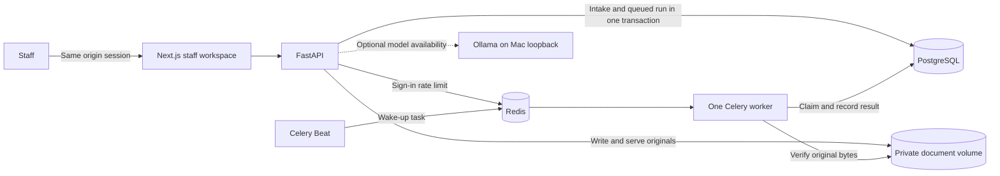

# Phase 0 audit and Phase 1 decisions

Audited on 2026-11-13. This workspace initially held an uncommitted documentation
pack only. The legacy source is the sibling `cdc_excel_matcher_v1` checkout at
`a42a7ae` plus local changes in four Python services and one test module. The new
`codex/shipping-ai-foundation` branch carries the legacy working code and tests,
including those changes. The source checkout, its branch, running container and
local records were left in place. No remote is configured for the new workspace.

- Legacy Streamlit `app.py`, `shipping_ui.py`, and `app_pages/` expose the shipment
  workspace, CDC review, templates and cut-stock preparation. The HTML `ui_demo/`
  is an in-memory demo. The Python services cover Excel INV/PL extraction and
  reconciliation, PDF B/L extraction with optional OCR, CDC ranking, translations,
  permit draft export, cut-stock workbook generation, and SQLite shipment storage.
- The legacy requirements cover Streamlit, openpyxl, xlrd, RapidFuzz, pandas,
  deep-translator and PyMuPDF. The legacy Compose service uses Python 3.11 and a
  persistent bind mount of `data/`. The already running service reported
  `healthy` and `GET /_stcore/health` returned `ok` on port 8501.
- Read-only SQLite inspection: one company, one shipment, five linked documents,
  zero shipment events, and six verified translations. PostgreSQL starts empty;
  there is no SQLite migration, auto-seed or report import in Phase 1.
- Baseline: from the original checkout, `.venv/bin/python -m unittest discover -s tests -v`
  passed all 34 tests with its private fixtures (Python 3.14.6). Pandas emitted an
  xlrd deprecation warning. Some tests need real legacy workbooks/PDFs; public
  source alone does not reproduce the full suite.
- The existing private reference directory, example spreadsheets, default
  workbooks, settings and translation data are kept out of the new repository
  and Phase 1 Docker contexts. Keep them in the original checkout or
  copy them into ignored local paths as documented. Legacy online translation is
  opt-in; the new stack never calls it.
- Host: arm64 macOS 26.6.2, 16 GB RAM, Git 2.51.2, Docker 29.0.1, Compose 2.40.3,
  Python 3.14.6 and 3.12.13, Node 26.12.1 and Corepack 0.34.2. Port 8000 is already
  used by another stack and 8501 by legacy; the new API defaults to loopback 8001
  and web to loopback 3000. Existing PostgreSQL on 5432 is unaffected.

## Decisions

- PostgreSQL is authoritative for intake and automation state. Use UUID keys,
  UTC timestamps, foreign keys, and numeric item quantities and money. Invoice
  numbers are display references and may repeat, even within a company until
  the agency confirms its business key. No shipment cardinality is assumed.
- Authenticated active staff share one internal workspace. Opaque expiring
  sessions, Argon2id password hashes, strict write Origin checks, same-origin
  web/API routing and private file responses are the local baseline. Real
  multi-company isolation, production auth and deployment need separate design.
- An import can be created only as a manually entered draft linked to an intake.
  A unique link prevents duplicate drafts for the same case. The Phase 1 schema
  admits only drafts; adding acceptance requires an approval design and migration.
  No intake or worker creates an import. Dates stay pending until a future
  reviewed workflow. Permit rules, transport relationships, CDC eligibility,
  balance definitions and broker authorization remain unresolved.
- Intake and its queued receipt job commit in one transaction. A single Celery
  worker executes jobs; Celery Beat wakes it to drain due PostgreSQL runs. A
  lease, bounded backoff, stable trace and manual retry recover lost work. The
  Phase 1 receipt job verifies archived bytes, then leaves the case awaiting review.
- Uploads are local development only. Private storage addresses originals by
  SHA-256, with append-only document metadata and explicit revision links. Hash
  deduplication is scoped to a message; a repeated provider ID with a different
  payload is rejected. Files are persisted before the DB commit; an interrupted
  transaction can leave an unreferenced blob. No automatic cleanup touches evidence.
- Ollama is optional. Only model availability is checked, using the local
  Qwen3.5 4B Q4 model setting. No generation, parsing, live connectors, outgoing
  communication, approvals, permit execution or stock actions in this phase.

## Phase 1 runtime

Dependency versions are resolved in `apps/api/uv.lock` and
`apps/web/pnpm-lock.yaml`. The stack verified on this Mac uses Docker image digests,
Python 3.12.16, Node 24.22.3, pnpm 10.34.9, FastAPI 0.162.5, Celery 5.7.0
and Next.js 16.4.6. No upgrades were applied to the existing legacy environment.

## Verification record

| Check | Result |
| --- | --- |
| Legacy `python -m unittest discover -s tests -v` | 34 passed in the original checkout and 34 passed in this checkout with provisioned private fixtures. |
| Legacy Docker build and health | Image built; an isolated smoke container returned `ok` from `/_stcore/health`. The original service remained healthy. Streamlit AppTest rendered Dashboard, Import matcher, Shipments and Settings without exceptions. |
| `uv run --project apps/api pytest apps/api/tests -q` | 11 passed against disposable Postgres and Redis, including concurrent replay, revision provenance, protected file streaming, draft-only enforcement, job retries and provider status. |
| `uv run --project apps/api ruff check apps/api` and `alembic check` | Passed; no migration drift. |
| `corepack pnpm lint`, `build`, `typecheck`, and `test:e2e` | Passed; one Chromium test exercised the Compose stack through the web UI. Inbox also rendered at 390 px without page overflow. |
| Ollama host bridge and model | Ollama 0.40.16 listened on Mac loopback only. From the API container the provider reported `ready` for `qwen3.5:4b-q4_K_M` after the model pull; missing-model and unavailable states were also verified. |
| `docker compose -f compose.dev.yml up -d --build --wait` and `restart` | Services started and the migration exited 0. After restart the session, case, source message, draft, and original bytes remained available. A fresh Celery health job succeeded. A separate synthetic INV/PL XLSX upload preserved the exact workbook and created no import. |

Phase 2 can reuse the legacy parsers through adapters and add evidence-linked
extractions, deterministic comparisons and optional structured AI proposals.
Acceptance, permit generation in the new workflow, live integrations and
outgoing communications remain in later phases.
